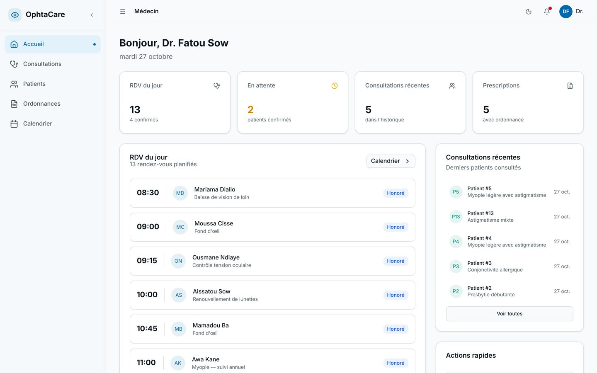
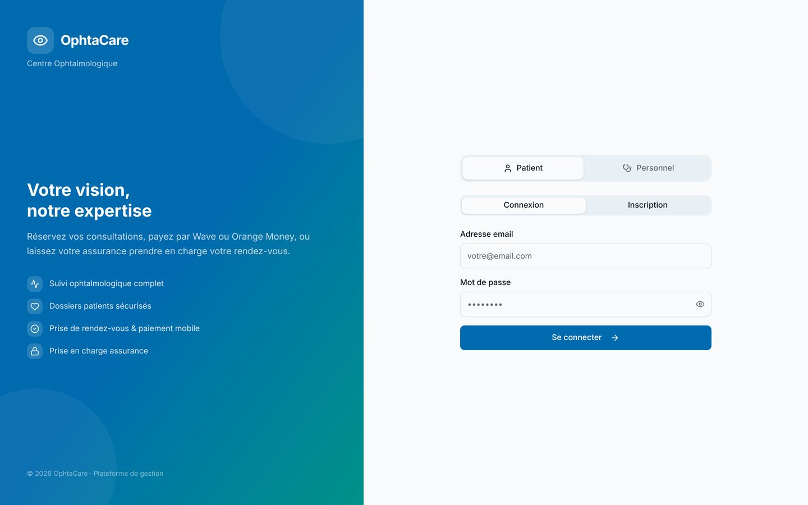
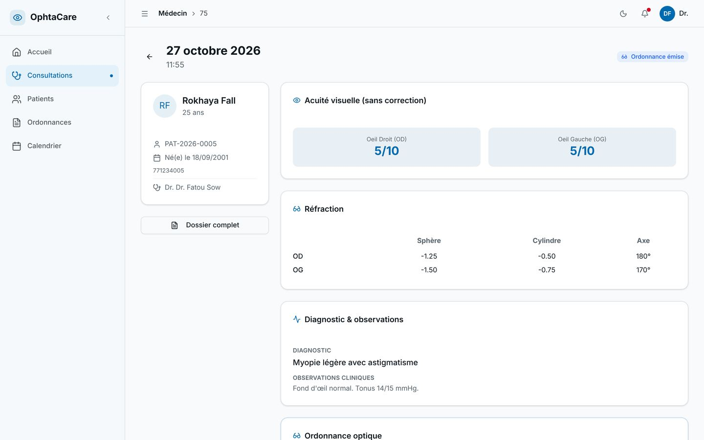
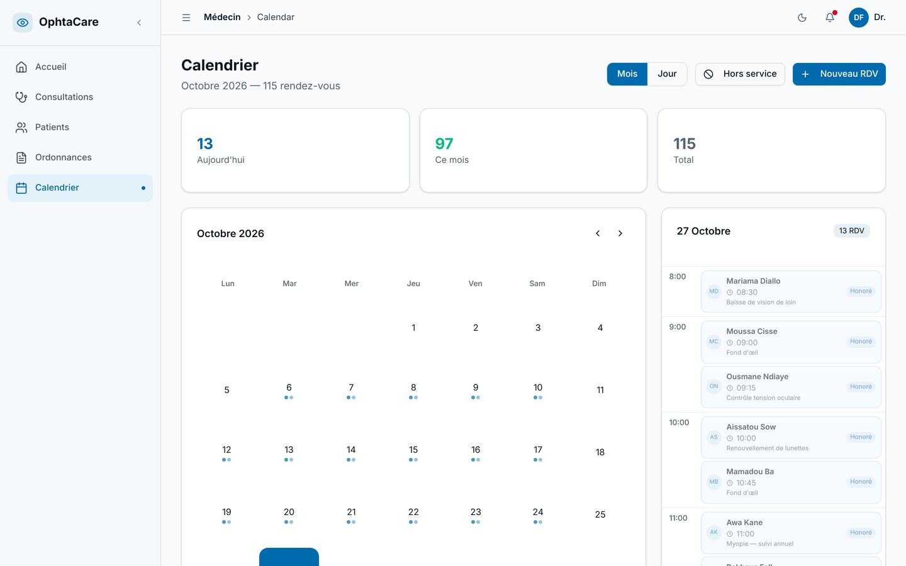
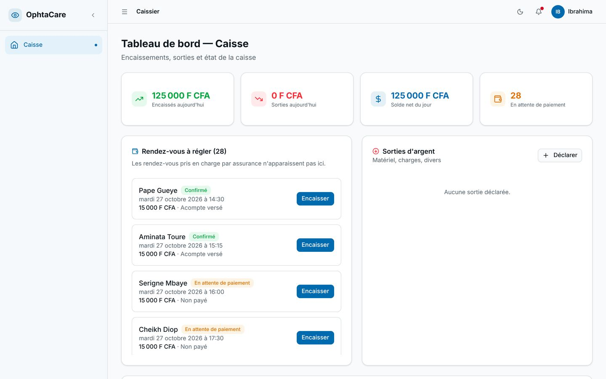
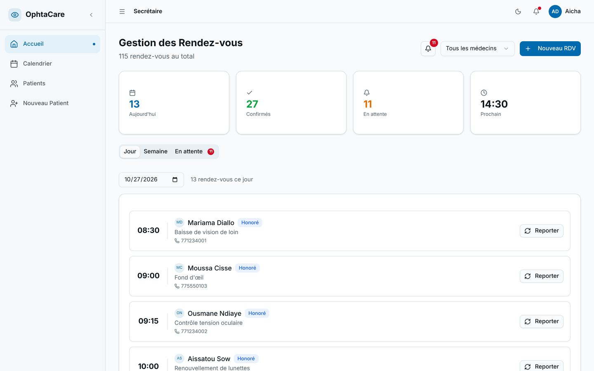
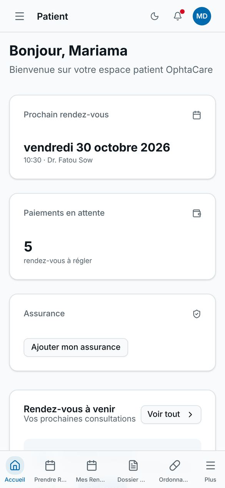

# OphtaCare

Plateforme de gestion de cabinets d'ophtalmologie, sur plusieurs cliniques : rendez-vous, caisse et paiement mobile, consultations de réfraction, ordonnances optiques et dossier patient.

Projet tutoré de fin d'année, ESMT Dakar, 2026. Encadrant : M. Moustapha Der.

*Ophthalmology clinic management platform (appointments, cash desk, mobile payment, refraction consultations, eyeglass prescriptions). Laravel 12 API + Next.js front-end. End-of-year tutored project at ESMT Dakar.*



## Ce que fait l'application

Chaque utilisateur a un rôle, et chaque rôle a son espace. Toutes les données sont cloisonnées par clinique.

| Rôle | Ce qu'il fait |
|---|---|
| Patient | S'inscrit en choisissant sa clinique, renseigne son assurance, prend rendez-vous (les créneaux hors service sont grisés), paie l'acompte par Wave ou Orange Money, consulte son dossier et imprime ses ordonnances. |
| Secrétaire | Tient l'agenda du jour et de la semaine pour tous les médecins, réserve, reporte ou annule, enregistre les nouveaux patients. |
| Médecin | Voit ses rendez-vous du jour, gère ses plages hors service, saisit la consultation (acuité visuelle, réfraction OD/OG, tonus, diagnostic) et rédige l'ordonnance optique. |
| Caissier | Encaisse au guichet les rendez-vous à régler et suit la recette du jour. |
| Admin de clinique | Gère le personnel de sa clinique, ses statistiques et ses journaux. |
| Super admin | Voit toutes les cliniques. |

Règle de paiement : un rendez-vous est validé quand le patient a versé 50 % du montant, ou 100 % de sa part quand une assurance prend le reste en charge.

Chaque ordonnance s'imprime sur le canevas de la clinique et porte une référence opticien valable 90 jours : l'opticien récupère la prescription sans compte (`GET /api/partenaire/prescription/{token}`).

## Architecture

```
frontend/   Next.js 16 · React 19 · TypeScript · Tailwind CSS 4 · shadcn/ui
   │  REST + jeton Bearer (Laravel Sanctum)
backend/    Laravel 12 · PHP 8.2+ · Sanctum
   │
MySQL 8 / MariaDB 10.6+
database/   ophtalmo_db.sql : schéma complet + données de démonstration de base
```

- Authentification par jetons Sanctum, rôle vérifié sur chaque route sensible.
- Diagnostic et observations cliniques chiffrés en base (cast `encrypted` de Laravel, AES-256 avec la clé de l'application).
- Journal d'activité et journal des transactions de paiement.
- Paiement mobile derrière une interface `PaymentProviderInterface` (fournisseurs Wave et Orange Money simulés pour l'instant).

## Équipe

| Membre | Rôle |
|---|---|
| Pape Souleymane Ndao | Modélisation, architecture et DevOps |
| Mouhammad Ndiaye | Back-end |
| Adama Ngom | Front-end |

## Lancer le projet

Prérequis : PHP 8.2+, Composer, Node.js 20+, MySQL 8 ou MariaDB 10.6+.

### API (backend/)

```bash
cd backend
composer install
cp .env.example .env
php artisan key:generate
# créer la base ophtalmo_db, puis renseigner DB_USERNAME / DB_PASSWORD dans .env
php artisan migrate --seed
php artisan db:seed --class=DemoSeeder   # optionnel : une journée de cabinet complète
php artisan serve                        # http://127.0.0.1:8000
```

Pour importer la base sans passer par les migrations : `mysql -u root -p < database/ophtalmo_db.sql`.

### Interface (frontend/)

```bash
cd frontend
npm install
cp .env.example .env.local   # NEXT_PUBLIC_API_URL=http://127.0.0.1:8000/api
npm run dev                  # http://localhost:3000
```

### Comptes de démonstration

Mot de passe pour tous : `password`.

| Rôle | E-mail |
|---|---|
| Super admin | superadmin@ophtalmo.sn |
| Admin de clinique | admin.dakar@ophtalmo.sn |
| Médecin | dr.sow@ophtalmo.sn |
| Secrétaire | secretaire.dakar@ophtalmo.sn |
| Caissier | caisse.dakar@ophtalmo.sn |
| Patient (après `DemoSeeder`) | patient.demo@ophtalmo.sn |

## Captures

| | |
|---|---|
|  |  |
|  |  |
|  |  |

Toutes les données affichées sont fictives.

## Limites connues

- Wave et Orange Money sont simulés. Le callback de paiement exige une signature HMAC (`PAYMENT_WEBHOOK_SECRET`, en-tête `X-Ophtacare-Signature`). Avec un vrai opérateur, il faudra la remplacer par son propre schéma de signature.
- La référence opticien est imprimée en clair : le QR code n'est pas encore généré. L'export PDF côté serveur est un emplacement réservé, l'impression passe par le navigateur.
- Les tests automatisés se limitent aux exemples Laravel. La recette a été faite à la main et avec Postman.
- Le caissier et la secrétaire peuvent lire les consultations de leur clinique. C'est un choix de dossier partagé, à restreindre.
- Côté interface :
  - la page « Journaux système » de l'admin ne se charge pas ;
  - la page « Statistiques » affiche des valeurs de maquette ;
  - les barres des graphiques s'affichent en noir.
- CORS n'autorise que localhost : ajouter le domaine du frontend dans `backend/config/cors.php` avant une mise en ligne.
- Le build du frontend télécharge la police Inter depuis Google Fonts.
